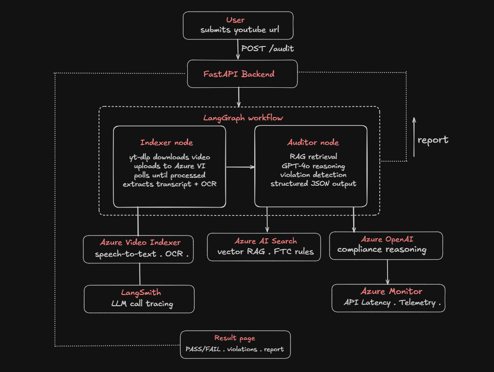

# Multimodal Video Compliance Auditor

Paste a YouTube ad URL and get a compliance verdict against FTC and YouTube advertising rules. Every violation comes with the exact quote, the timestamp, and a severity, so a reviewer can verify each finding instead of trusting the model.



## How it works

The audit is a three-stage pipeline orchestrated with LangGraph: **Evidence → Rules → Verdict**.

| Stage | What happens | Tech |
|---|---|---|
| 1. Extract evidence | The ad is downloaded and indexed to produce a timestamped transcript and on-screen text (OCR) | yt-dlp, Azure Video Indexer |
| 2. Retrieve rules | One targeted query per compliance category against the policy knowledge base (FTC and YouTube guideline PDFs), results deduplicated | Azure AI Search, Azure OpenAI embeddings |
| 3. Judge | An LLM compares the evidence against the retrieved rules and returns structured violations; **PASS/FAIL is decided in code** | Azure OpenAI, Pydantic |

If any stage fails, the graph stops and the API returns a distinct `ERROR` status instead of a misleading verdict.

## Design decisions

- **Code decides PASS/FAIL, not the LLM.** The model finds and explains violations. The policy (any CRITICAL or MAJOR violation fails the ad) is an explicit, testable function in `services/judge.py`.
- **Structured output instead of parsing text.** The verdict is validated against a Pydantic schema, so malformed output fails loudly rather than silently.
- **Per-category retrieval.** Each of the seven compliance categories gets its own short query. Embedding a whole transcript as one query produces a diluted vector.
- **Evidence-first findings.** Each violation must include a verbatim quote and the timestamp it came from.
- **Dependency injection.** The retriever, indexer and LLM are injected into the graph nodes. The `RuleRetriever` protocol means the retrieval backend can be swapped without touching the pipeline, and the nodes can be unit-tested without Azure.
- **Fail-fast configuration.** All environment variables are validated once at startup.

## Compliance categories checked

FTC disclosure · Claim validation · Endorsement disclosure · Ad specs · Misleading content · Professional misrepresentation · Trademark

## Tech stack

**Backend:** Python, FastAPI, LangGraph, LangChain, Pydantic, Azure OpenAI, Azure AI Search, Azure Video Indexer, Azure Monitor (OpenTelemetry)
**Frontend:** Next.js, React, TypeScript, Tailwind CSS, shadcn/ui

## Project structure

```
ComplianceQAPipeline/
├── main.py                       # CLI entry point
└── backend/
    ├── data/                     # policy PDFs (knowledge base source)
    ├── scripts/index_documents.py  # chunk, embed and index the PDFs
    ├── src/
    │   ├── config.py             # validated settings
    │   ├── schemas.py            # Pydantic models and API contract
    │   ├── prompts.py            # prompts and category guide
    │   ├── api/                  # FastAPI app, telemetry
    │   ├── graph/                # LangGraph state, nodes, workflow
    │   └── services/             # downloader, video indexer, retriever, judge
    └── tests/
frontend/                         # Next.js UI
```

## Getting started

### Prerequisites

- Python 3.11+ and [uv](https://docs.astral.sh/uv/)
- Node.js 18+
- An Azure subscription with: Azure OpenAI (chat and embedding deployments), Azure AI Search, and Azure Video Indexer
- Azure credentials available to `DefaultAzureCredential` (for example `az login`)

### 1. Configure environment

Create `ComplianceQAPipeline/.env`:

```env
AZURE_OPENAI_ENDPOINT=
AZURE_OPENAI_API_KEY=
AZURE_OPENAI_API_VERSION=2024-02-01
AZURE_OPENAI_CHAT_DEPLOYMENT=
AZURE_OPENAI_EMBEDDING_DEPLOYMENT=text-embedding-3-small

AZURE_SEARCH_ENDPOINT=
AZURE_SEARCH_API_KEY=
AZURE_SEARCH_INDEX_NAME=

AZURE_VI_ACCOUNT_ID=
AZURE_VI_LOCATION=
AZURE_VI_NAME=
AZURE_SUBSCRIPTION_ID=
AZURE_RESOURCE_GROUP=

# optional
APPLICATIONINSIGHTS_CONNECTION_STRING=
CORS_ORIGINS=http://localhost:3000
```

### 2. Index the policy documents

```bash
cd ComplianceQAPipeline
uv sync
uv run python -m backend.scripts.index_documents
```

### 3. Run the API

```bash
uv run uvicorn backend.src.api.server:app --reload
```

The API runs at `http://localhost:8000` (interactive docs at `/docs`).

### 4. Run the frontend

```bash
cd frontend
echo "NEXT_PUBLIC_API_URL=http://localhost:8000" > .env.local
npm install
npm run dev
```

Open `http://localhost:3000`.

### CLI usage

```bash
uv run python main.py "https://youtu.be/<video-id>"
```

### Tests

```bash
uv run pytest
```

## API

`POST /audit`

```json
{ "video_url": "https://youtu.be/..." }
```

Response:

```json
{
  "session_id": "…",
  "video_id": "vid_ab12cd34",
  "status": "FAIL",
  "final_report": "Summary and recommended actions…",
  "compliance_results": [
    {
      "category": "FTC Disclosure",
      "severity": "CRITICAL",
      "description": "Sponsored content with no clear disclosure.",
      "evidence": "exact quote from the video",
      "timestamp": "0:00:12"
    }
  ]
}
```

`status` is one of `PASS`, `FAIL`, or `ERROR`. `GET /health` is a liveness check.

## Evaluation

<!-- fill in: only report numbers you have actually measured -->

| Metric | Result |
|---|---|
| Labeled ads | N |
| Violation detection precision | – |
| Violation detection recall | – |

## Limitations

- Video analysis (transcription, OCR) relies on Azure Video Indexer, so audit quality depends on its extraction.
- Only YouTube URLs are supported.
- `/audit` is synchronous and takes a few minutes per video.
- The LLM can over-flag or miss violations. Findings carry evidence so a human can verify them, but this is a review aid, not legal advice.

## Roadmap

- **Async job processing:** return a job ID from `POST /audit` and stream per-stage progress (extract, retrieve, judge) to the UI, instead of holding one request open for minutes
- **Parallel category judging:** run the seven compliance checks concurrently to cut latency, with retries and validation-error recovery on malformed LLM output
- **Multi-source input:** support direct video file uploads and other platforms, not just YouTube URLs
- **Audit history and reporting:** persist past audits in a database, with search, filtering by category or severity, and PDF export of reports